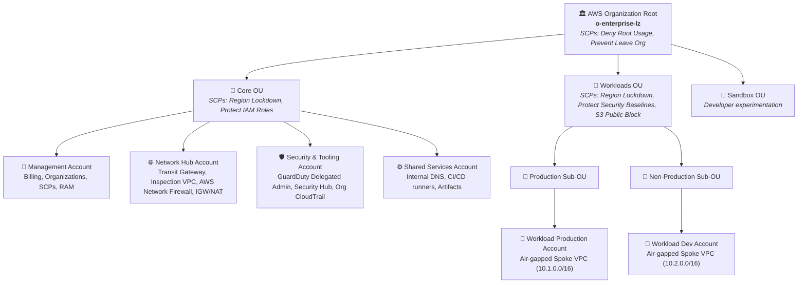
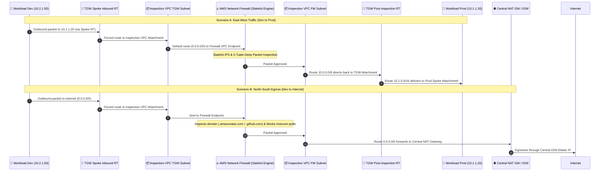

<div align="center">

# 🏛️ AWS Multi-Account Enterprise Landing Zone & Transit Gateway Hub

**Production-grade, zero-trust multi-account architecture featuring AWS Organizations, Service Control Policies (SCPs) Guardrails, Centralized Inspection with AWS Network Firewall, and Terragrunt Orchestration.**

[](https://www.terraform.io/)
[](https://terragrunt.gruntwork.io/)
[](https://aws.amazon.com/)
[](https://www.python.org/)
[](https://github.com/ekrmcakir/aws-multi-account-landing-zone/actions)
[](#security-guardrails--scps)
[](LICENSE)

</div>

---

## 📌 Executive Summary

Enterprise cloud architectures strictly forbid running production, staging, shared tooling, and security auditing within a single monolithic AWS account. A single compromised IAM credential or malicious lateral movement in a flat account can result in catastrophic cross-environment data breach and uncontrolled blast radius.

This repository implements a **production-ready AWS Multi-Account Landing Zone** built with modular **Terraform** and **Terragrunt**:

1. **AWS Organizations & Immutable Guardrails (SCPs):** Hierarchical Organizational Units (`Core`, `Workloads`, `Sandbox`) protected by deterministic Service Control Policies that enforce regional data residency, eliminate AWS root account usage, lock down security monitoring tools (CloudTrail, GuardDuty, AWS Config, VPC Flow Logs), and block public S3 exposures.
2. **Centralized Hub-and-Spoke Network Mesh:** An **AWS Transit Gateway (TGW)** architecture that segments Spoke VPCs (Production, Non-Production/Dev, Shared Services) and forces all traffic through a **Centralized Inspection VPC** equipped with **AWS Network Firewall**.
3. **No Spoke-to-Spoke Bypass:** East-West traffic (Dev to Prod) and North-South traffic (Workloads to Internet) are symmetrically routed through stateful Suricata-compatible inspection rules before reaching any destination or central egress NAT Gateway.
4. **Automated Verification & Interactive Visualizer:** Includes a deterministic routing simulator in Python, automated SCP policy schema tests, and a standalone single-page visual dashboard (`dashboard.html`) for tracing packet hops in real-time.

---

## 🏗️ Architectural Topology

### 1. AWS Organizations & Organizational Unit (OU) Hierarchy



---

### 2. Centralized Hub-and-Spoke Traffic Inspection (Transit Gateway + Network Firewall)



---

## 🔒 Security Guardrails & SCPs

All accounts are governed by Service Control Policies deployed at the Organization Root and OU layers:

| Policy Name | Target OU | Enforced Security Rule | Effect |
| :--- | :--- | :--- | :---: |
| **`SCP-DenyRootAccountUsage`** | Root (All Accounts) | Prohibits any API or console action initiated by AWS account root credentials (`arn:aws:iam::*:root`). | **`DENY`** |
| **`SCP-PreventLeavingOrganization`** | Root (All Accounts) | Prevents member accounts from attempting `organizations:LeaveOrganization`. | **`DENY`** |
| **`SCP-DenyUnauthorizedRegions`** | Core, Workloads | Denies all actions outside approved regions (`eu-central-1`, `eu-west-1`, `us-east-1`), exempting global services (IAM, STS, Route53, CloudFront). | **`DENY`** |
| **`SCP-ProtectSecurityBaselines`** | Workloads | Blocks disabling or deleting CloudTrail, GuardDuty, AWS Config, Security Hub, and VPC Flow Logs. | **`DENY`** |
| **`SCP-EnforceS3EncryptionAndBlockPublic`** | Workloads | Disallows unencrypted S3 object uploads (`Null: s3:x-amz-server-side-encryption`) and denies disabling S3 Public Access Block. | **`DENY`** |
| **`SCP-ProtectSecurityRoles`** | Core, Workloads | Disallows updating, detaching policies, or deleting core administrative and security audit roles (`LandingZoneAdminRole`, `SecurityAuditRole`). | **`DENY`** |

---

## 🌐 Network CIDR & Subnet Allocation Matrix

| Account / VPC | CIDR Block | Subnets | Purpose |
| :--- | :--- | :--- | :--- |
| **Network Hub (Inspection VPC)** | `10.0.0.0/16` | `10.0.1.0/24`, `10.0.2.0/24`<br/>`10.0.11.0/24`, `10.0.12.0/24`<br/>`10.0.21.0/24`, `10.0.22.0/24` | • TGW Attachment ENIs<br/>• AWS Network Firewall Endpoints<br/>• Central Public NAT Gateways &amp; IGW |
| **Workload Production** | `10.1.0.0/16` | `10.1.1.0/24`, `10.1.2.0/24`<br/>`10.1.10.0/24`, `10.1.11.0/24`<br/>`10.1.100.0/24`, `10.1.101.0/24` | • Production App Tier<br/>• Production Database Tier<br/>• TGW Attachment Subnet (No IGW/NAT) |
| **Workload Development** | `10.2.0.0/16` | `10.2.1.0/24`, `10.2.2.0/24`<br/>`10.2.10.0/24`, `10.2.11.0/24`<br/>`10.2.100.0/24`, `10.2.101.0/24` | • Dev App Tier<br/>• Dev Database Tier<br/>• TGW Attachment Subnet (No IGW/NAT) |
| **Shared Services** | `10.3.0.0/16` | `10.3.1.0/24`, `10.3.2.0/24`<br/>`10.3.100.0/24`, `10.3.101.0/24` | • Internal CI/CD Runners &amp; Private DNS<br/>• TGW Attachment Subnet |

---

## 📁 Repository Structure

```
aws-multi-account-landing-zone/
├── .github/workflows/
│   ├── terraform-ci.yml           # Formats, schema-validates all modules
│   └── policy-validator.yml       # Runs Python SCP & TGW simulation tests
├── dashboard.html                 # Interactive Visual Topology & Packet Tracer
├── terragrunt.hcl                 # Root Terragrunt configuration (State + Provider)
├── environments/
│   ├── _env/                      # Reusable component templates
│   │   ├── organizations.hcl
│   │   ├── network-hub.hcl
│   │   └── spoke-vpc.hcl
│   ├── account-management/        # AWS Organizations, OUs, and SCP Attachments
│   ├── account-network-hub/       # Transit Gateway, Inspection VPC, Firewall
│   ├── account-workload-prod/     # Production Spoke VPC
│   ├── account-workload-dev/      # Development Spoke VPC
│   └── account-shared-services/   # Shared Services Spoke VPC
├── modules/
│   ├── aws-organizations/         # AWS Org, OUs, accounts, and SCP definitions
│   │   ├── policies/              # JSON definitions for all 6 SCP guardrails
│   │   ├── main.tf
│   │   ├── variables.tf
│   │   └── outputs.tf
│   ├── transit-gateway-hub/       # TGW resource, segmented RTs, and RAM sharing
│   ├── central-network-firewall/  # Inspection VPC, Suricata IPS rules, NAT GWs
│   └── spoke-vpc/                 # Air-gapped Spoke VPC with TGW Attachment
├── tests/
│   ├── test_scp_policies.py       # Validates JSON schema, Sids, and region rules
│   └── test_tgw_routing_simulator.py # Deterministic packet tracer verification
└── scripts/
    └── validate_landing_zone.sh   # One-click validation and test runner
```

---

## 🚀 Deployment Guide (Terragrunt Orchestration)

### Prerequisites
- [Terraform](https://www.terraform.io/) >= 1.5.0
- [Terragrunt](https://terragrunt.gruntwork.io/) >= 0.50.0
- AWS CLI configured with cross-account landing zone credentials

### 1. Provision AWS Organizations & SCPs (Management Account)
```bash
cd environments/account-management
terragrunt apply
```

### 2. Provision Central Transit Gateway & Firewall (Network Hub Account)
```bash
cd ../account-network-hub
terragrunt apply
```

### 3. Provision Workload Spokes (Production & Dev Accounts)
```bash
cd ../account-workload-prod
terragrunt apply

cd ../account-workload-dev
terragrunt apply
```

---

## 🧪 Testing & Validation

Run the automated test suite locally to verify SCP syntax and test packet trajectories across the simulated routing tables:

```bash
# Execute the comprehensive validation script
./scripts/validate_landing_zone.sh
```

Sample output:
```text
==========================================================
 AWS Multi-Account Landing Zone Architecture Validator
==========================================================
[1/4] Checking Terraform formatting...
[2/4] Running SCP Policy syntax & guardrail tests...
Ran 5 tests in 0.002s - OK
[3/4] Running Transit Gateway deterministic routing simulator...
Ran 4 tests in 0.000s - OK
[4/4] Validating Terraform module schemas...
  --> Validating module: aws-organizations (Success)
  --> Validating module: transit-gateway-hub (Success)
  --> Validating module: central-network-firewall (Success)
  --> Validating module: spoke-vpc (Success)
==========================================================
 SUCCESS: All Landing Zone validations and tests passed!
==========================================================
```

---

## 🖥️ Interactive Architecture & Packet Tracer Dashboard

Open [`dashboard.html`](dashboard.html) in any web browser to explore:
- The **real-time visual topology** showing member accounts, OUs, and VPC attachments.
- The **Interactive Packet Tracer**: select packet source and destination, and observe the animated step-by-step routing evaluation through TGW, Central Firewall, and NAT Gateways.
- The **SCP Guardrails Matrix** detailing all 6 active policies and their target OUs.

---

## 📄 License

This project is licensed under the MIT License - see the [LICENSE](LICENSE) file for details.
